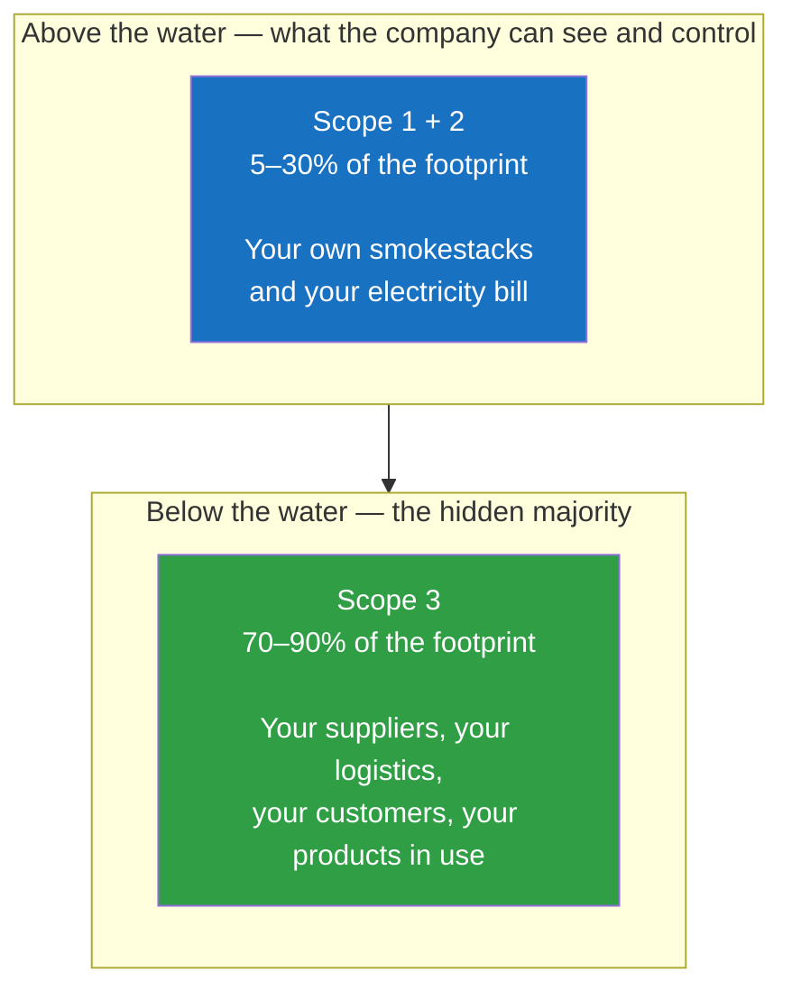
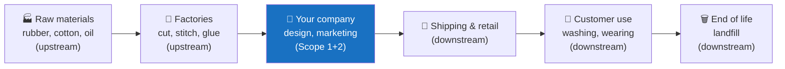

# Scope 3 101: A Beginner's Primer

> **📚 [Scope 3 Challenge](README.md)** · Part 9 of 16 · [← Industry Data & Benchmarks](07_industry_data_and_benchmarks.md) · [Next: Worked Example →](09_worked_example.md)

<strong>📑 Contents</strong>

- [The 60-Second Version](#the-60-second-version)
- [The Big Idea in One Analogy](#the-big-idea-in-one-analogy)
- [The Three Scopes, Explained Simply](#the-three-scopes-explained-simply)
- [Upstream vs. Downstream: A Product's Journey](#upstream-vs-downstream-a-products-journey)
- [A Mini Worked Example](#a-mini-worked-example)
- [The 15 Categories, in Plain English](#the-15-categories-in-plain-english)
- [Common Misconceptions, Busted](#common-misconceptions-busted)
- [Why This Matters to You](#why-this-matters-to-you)
- [Test Yourself](#test-yourself)
- [Where to Go Next](#where-to-go-next)

> **Who this is for:** anyone new to Scope 3 — a board member, a marketer, a junior analyst, or just a curious person. No prior knowledge assumed. When you finish, you'll understand *what* Scope 3 is, *why* it matters, and *where the hard parts are*. Each section points to the deeper treatment in the rest of the guide.

---

## The 60-Second Version

Every company has a carbon footprint. We divide it into three "scopes":

- **Scope 1** — emissions from things the company **directly owns or controls** (its boilers, its delivery vans, its factory furnaces).
- **Scope 2** — emissions from the **electricity and energy it buys**.
- **Scope 3** — emissions from **everything else in its value chain**: the suppliers it buys from, the transport of its goods, and what customers do with its products after they buy them.

Here's the punchline that matters: **for most companies, Scope 3 is 70–90% of the total footprint.** A car maker's tailpipe emissions, a bank's loan book, a fashion brand's cotton fields and dyeing mills — none of those show up in Scope 1 or 2. If you only measure Scopes 1 and 2, you're seeing a small slice of the picture.

---

## The Big Idea in One Analogy

Think of a company's footprint as an **iceberg**.

The iceberg isn't just *bigger* below the water — it's also **harder to see**. A company can read its own electricity bill. It cannot read its supplier's supplier's energy mix, or predict how many kilometres a customer will drive the car it sold.

**This is the whole problem in one sentence:** the most important part of a company's footprint is the part it can least easily measure and least directly control.

---

## The Three Scopes, Explained Simply

| Scope | What it covers | Simple question it answers | Who controls it |
|-------|---------------|---------------------------|-----------------|
| **1** | Fuel you burn, processes you run, leaks from your equipment | "What do *we* emit directly?" | You, fully |
| **2** | Electricity, steam, heat you buy | "What emissions hide in the *energy we purchase*?" | You, partially (you choose the supplier) |
| **3** | Your whole value chain, up and down | "What emissions does *our existence* cause, beyond our four walls?" | You, indirectly at best |

> The exact definitions and the 15 Scope 3 categories are unpacked in [01 Fundamentals](01_scope3_fundamentals.md).

---

## Upstream vs. Downstream: A Product's Journey

Follow a single product — say, a **pair of running shoes** — through its life, and you can see where Scope 3 lives:

- **Upstream (Categories 1–8):** everything that happens *before* the product reaches you — the materials you buy and how they got to you.
- **Downstream (Categories 9–15):** everything that happens *after* you sell it — shipping it out, the customer using it, and its disposal.

Most of the emissions in that picture belong to someone *else's* operations — the rubber plantation, the factory, the customer's washing machine. Yet under the GHG Protocol, **your company is asked to account for them anyway**, because your decisions (what you buy, what you design, who you sell to) influence them.

---

## A Mini Worked Example

Let's make it concrete with a fictional company, **Good Bean Coffee Co.**, that roasts and sells coffee. (Every number is illustrative — chosen to be round, not real.)

| Step | Emission source | Which scope? |
|------|----------------|--------------|
| Growing the beans | Fertiliser on the farm, farm machinery | Scope 3 (upstream, Cat 1) |
| Shipping green beans | Cargo ship + trucks | Scope 3 (upstream, Cat 4) |
| **Roasting** | Gas burned in Good Bean's roaster | **Scope 1** |
| **Powering the roastery** | Electricity Good Bean buys | **Scope 2** |
| Selling + delivering | Retailer's energy, delivery vans | Scope 3 (downstream, Cat 9) |
| Brewing at home | Customer's kettle/electricity | Scope 3 (downstream, Cat 11) |
| Disposing the bag | Landfill methane | Scope 3 (downstream, Cat 12) |

Now the key observation: Good Bean *directly* controls only the roasting step (Scope 1) and the electricity it buys (Scope 2). **Everything else — the farm, the ship, the kettle — is Scope 3.** For a company like Good Bean, Scope 3 might be 90%+ of the total.

> Want to see the full arithmetic, category by category, with real emission factors and the difference between methods? That's [09 Worked Example](09_worked_example.md).

---

## The 15 Categories, in Plain English

The GHG Protocol splits Scope 3 into 15 numbered categories. Here they are translated from "standard-ese" into plain language:

| # | Plain-English name | "In one line" |
|---|--------------------|---------------|
| **1** | Purchased goods & services | The carbon inside *everything you buy* |
| **2** | Capital goods | The carbon inside *equipment and buildings* you buy |
| **3** | Fuel- & energy-related | The carbon used to *make and move your energy* |
| **4** | Upstream transport | Getting your *purchases* to your door |
| **5** | Waste in operations | The carbon from your *rubbish* |
| **6** | Business travel | Your people's *flights and hotels* |
| **7** | Employee commuting | Your people's *daily commute* |
| **8** | Upstream leased assets | Carbon from *things you rent* |
| **9** | Downstream transport | Getting your *products* to customers |
| **10** | Processing of sold products | What customers *do to* your product |
| **11** | Use of sold products | Your product's carbon *while it's being used* |
| **12** | End-of-life treatment | Your product's *disposal or recycling* |
| **13** | Downstream leased assets | Carbon from *things you rent out* |
| **14** | Franchises | Carbon from *franchisees* using your brand |
| **15** | Investments | Carbon from *what you finance* |

**Not all 15 matter for everyone.** A bank lives almost entirely in Category 15; a car maker lives in Category 11; a fashion brand in Category 1. The trick is working out which few categories dominate *your* footprint — see [01 Fundamentals](01_scope3_fundamentals.md) for the sector-by-sector map.

---

## Common Misconceptions, Busted

**"Scope 3 is someone else's problem."**
No — it's *everyone's* problem at once. Your supplier's Scope 1 is your Scope 3 Category 1. The GHG Protocol deliberately lets the same physical tonne appear in multiple companies' books.

**"Offsets fix my Scope 3."**
No. Buying a forest-protection credit outside your value chain does not reduce the emissions inside your supply chain, and standards increasingly restrict that use. See [04 Abatement Challenges](04_abatement_challenges.md).

**"If I can't measure it precisely, it's not worth reporting."**
No — that's backwards. Reporting your best estimate *with its uncertainty stated* is more honest than silence. The risk is pretending a spend-based estimate is precise; see [02 Complexity](02_complexity_challenges.md).

**"Scope 3 is just a reporting exercise."**
No — the whole point is *action*. Measuring tells you where the emissions are; it does not reduce them. The gap between the two is the subject of [04 Abatement Challenges](04_abatement_challenges.md).

**"Only big companies need to care."**
No — small companies are *inside* someone else's Scope 3. As regulation tightens, buyers will demand data from their suppliers, which means the question flows downhill to SMEs. See [06 Standards](06_standards_regulatory.md).

---

## Why This Matters to You

| If you are… | Scope 3 is your… |
|-------------|------------------|
| **Board member / executive** | Biggest hidden risk — and your net-zero pledge is hollow without it |
| **Sustainability lead** | Your day job: measuring, reporting, and reducing it |
| **Procurement** | Your supplier choices *are* the main lever on Scope 3 |
| **Finance / risk** | A fast-emerging liability and a data problem |
| **Product / engineering** | A design problem — Category 11 is decided at the drawing board |
| **Supplier / SME** | Your competitive advantage — the buyers are coming to ask |

---

## Test Yourself

Five quick checks. Click to reveal the answer.

<strong>1. A company switches its factory to 100% renewable electricity. Which scope did it just reduce?</strong>

**Scope 2** — purchased electricity is Scope 2 (under the market-based method). Its *suppliers* switching to renewables would be the company's Scope 3, Category 1.

<strong>2. A bank reports its financed emissions. Which Scope 3 category is that?</strong>

**Category 15 (Investments)** — the emissions of the companies it lends to and invests in.

<strong>3. Why can the same tonne of CO₂ appear in two companies' Scope 3 accounts?</strong>

Because Scope 3 is a *company-level* risk tool, not a system inventory. Your supplier's Scope 1 (the furnace) is also your Scope 3 Category 1 (the steel you bought). Double-counting across companies is by design.

<strong>4. What's the difference between upstream and downstream?</strong>

Upstream = before the product reaches you (what you buy, Cat 1–8). Downstream = after you sell it (distribution, use, disposal, Cat 9–15).

<strong>5. "We bought offsets to neutralise our residual Scope 3." Is that a reduction of Scope 3?</strong>

No. Offsets occur outside your value chain and are not attributable to a Scope 3 category. Insetting (reductions *within* your chain) is the direction the standards are moving. See [04](04_abatement_challenges.md) and [05](05_carbon3_solution.md).

---

## Where to Go Next

- **Understand the categories properly** → [01 Fundamentals](01_scope3_fundamentals.md)
- **See the full calculation with real arithmetic** → [09 Worked Example](09_worked_example.md)
- **Learn why it's *hard*** → [02 Complexity](02_complexity_challenges.md)
- **Avoid the classic errors** → [10 Common Mistakes](10_common_mistakes.md)
- **Grab the one-page cheat sheet** → [15 Quick Reference](15_quick_reference.md)

---

## Key Takeaways

- Scope 3 is **70–90% of most companies' footprint** — the hidden part of the iceberg.
- It is **not optional, not someone else's problem, and not solved by offsets**.
- The 15 categories reduce to one idea: **everything up and down your value chain**.
- Measuring is the *first* step; **reducing is the real challenge**.

---

**← Previous:** [Industry Data & Benchmarks](07_industry_data_and_benchmarks.md) &nbsp;·&nbsp; **Next:** [Worked Example](09_worked_example.md) → &nbsp;·&nbsp; **[📚 Guide Index](README.md)**
