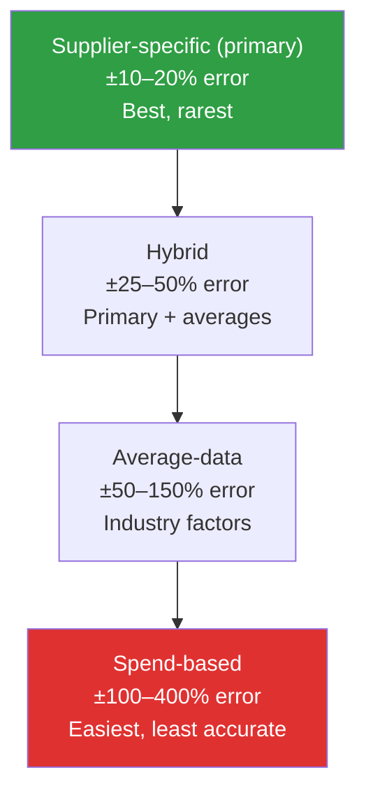
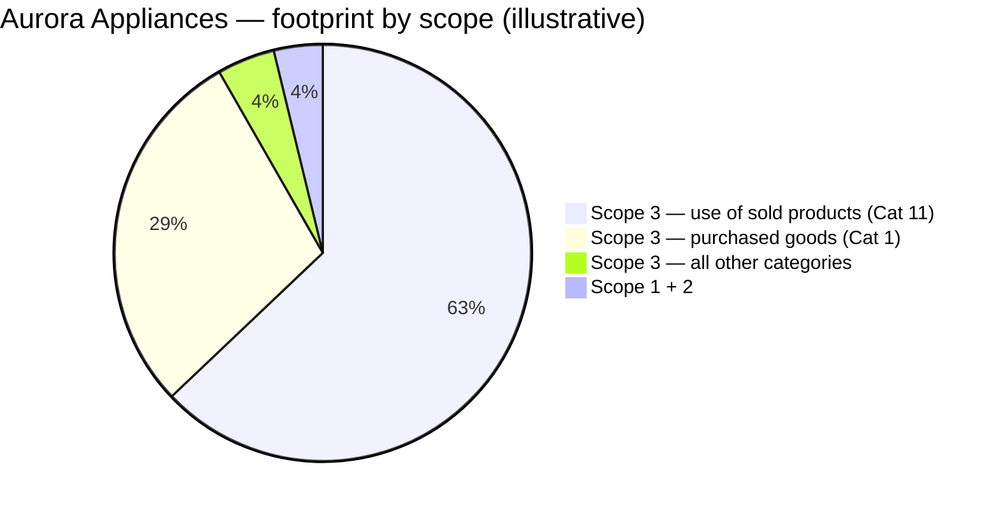

# Worked Example: From Raw Data to a Scope 3 Inventory

> **📚 [Scope 3 Challenge](README.md)** · Part 10 of 16 · [← Scope 3 101](08_scope3_101.md) · [Next: Common Mistakes →](10_common_mistakes.md)

<strong>📑 Contents</strong>

- [What This Is (and Isn't)](#what-this-is-and-isnt)
- [Step 0: The Company and Its Boundary](#step-0-the-company-and-its-boundary)
- [Step 1: Collect Activity Data](#step-1-collect-activity-data)
- [Step 2: Choose a Calculation Method per Category](#step-2-choose-a-calculation-method-per-category)
- [Step 3: Apply Emission Factors](#step-3-apply-emission-factors)
- [Step 4: Total and the Scope 3 Share](#step-4-total-and-the-scope-3-share)
- [Step 5: Sensitivity — What If the Method Changes?](#step-5-sensitivity--what-if-the-method-changes)
- [Step 6: Materiality and Next Actions](#step-6-materiality-and-next-actions)
- [Try It Yourself](#try-it-yourself)

## What This Is (and Isn't)

> **What this is:** a complete, end-to-end Scope 3 inventory calculation for a fictional company, showing the *mechanics* — what data you need, how you choose methods, how the arithmetic works, and how sensitive the answer is to your choices.
>
> **What it isn't:** real company data. Every figure is illustrative, chosen to be round and internally consistent. Emission factors in reality vary widely by geography and database — see [02 Complexity](02_complexity_challenges.md) and [07 Data](07_industry_data_and_benchmarks.md).

---

## Step 0: The Company and Its Boundary

**Aurora Appliances Ltd.** — a fictional mid-sized manufacturer of refrigerators and washing machines.

| Attribute | Value |
|-----------|-------|
| Product | Household appliances |
| Employees | 5,000 |
| Annual sales | 1.2 million units |
| Markets | Europe |
| Own operations | Assembly plants + one component plant |
| **Scope 1** (direct fuel/process) | **40,000 tCO₂e** |
| **Scope 2** (purchased electricity, market-based) | **25,000 tCO₂e** |

The question we're answering: **what is Aurora's total Scope 3, and which categories dominate?**

---

## Step 1: Collect Activity Data

Before any calculation, you gather *activity data* — the physical or financial quantities that drive emissions. This is the hard, unglamorous part.

| Category | Activity data you'd need | Aurora's figure (illustrative) |
|----------|--------------------------|-------------------------------|
| 1 — Purchased goods & services | Spend by supplier + what they sell you | €900M materials |
| 2 — Capital goods | Capex on equipment & buildings | €60M |
| 3 — Fuel- & energy-related | Energy purchased (upstream lifecycle) | 100 GWh electricity |
| 4 — Upstream transport | Tonne-kilometres of inbound freight | 40M t·km |
| 5 — Waste in operations | Tonnes to landfill/incineration | 2,000 t |
| 6 — Business travel | Passenger-kilometres by mode | 15M p·km (air) |
| 7 — Employee commuting | Commute distance × mode × days | 32M p·km |
| 9 — Downstream transport | Outbound tonne-kilometres | 30M t·km |
| 11 — Use of sold products | Units sold × lifetime energy use | 1.2M units |
| 12 — End-of-life | Units retired × mass × disposal route | 72,000 t disposed |

> Notice the asymmetry: Categories 1 and 11 need completely different data — *spend* versus *lifetime energy modelling* — yet both sit in the same inventory.

---

## Step 2: Choose a Calculation Method per Category

Not all categories get the same treatment. The GHG Protocol offers four methods, in decreasing accuracy:

For Aurora, a realistic (and honest) mix is:

- **Cat 1** → *spend-based* initially (no supplier data yet), upgraded to *hybrid* as suppliers report.
- **Cat 11** → *activity-based model* (units × rated energy × lifetime), not a simple factor.
- **Cat 3, 4, 5, 6, 7, 9, 12** → *average-data* factors.
- **Cat 2** → *spend-based* (capex is episodic and hard to allocate otherwise).

---

## Step 3: Apply Emission Factors

An emission factor (EF) converts activity data into CO₂e. The core equation is simply:

> **Emissions = Activity data × Emission factor**

| Category | Activity × EF | Result (tCO₂e) |
|----------|---------------|----------------|
| 1 — Purchased goods | €900M × 0.55 kg CO₂e/€ | **495,000** |
| 2 — Capital goods | €60M × 0.40 kg CO₂e/€ | **24,000** |
| 3 — Energy-related | 100 GWh × 0.06 kg CO₂e/kWh | **6,000** |
| 4 — Upstream transport | 40M t·km × 0.08 kg/t·km | **3,200** |
| 5 — Waste | 2,000 t × 0.60 kg CO₂e/kg | **1,200** |
| 6 — Business travel | 15M p·km × 0.15 kg/p·km | **2,250** |
| 7 — Commuting | 32M p·km × 0.05 kg/p·km | **1,600** |
| 9 — Downstream transport | 30M t·km × 0.09 kg/t·km | **2,700** |
| 11 — Use of sold products | 1.2M units × 300 kWh/yr × 12 yr × 0.25 kg/kWh | **1,080,000** |
| 12 — End-of-life | 72,000 t × 0.50 kg CO₂e/kg | **36,000** |
| **Total Scope 3** | | **≈ 1,652,000 tCO₂e** |

> **Watch Category 11's arithmetic:** 1.2M units × 300 kWh/yr × 12 years = 4.32 billion kWh of *lifetime* customer electricity — multiplied by a grid factor of 0.25 kg/kWh. The lifetime assumption (12 years) and the grid factor do most of the work, and neither is fully in Aurora's control.

---

## Step 4: Total and the Scope 3 Share

| Scope | tCO₂e | Share of total |
|-------|-------|----------------|
| Scope 1 | 40,000 | 2.3% |
| Scope 2 | 25,000 | 1.5% |
| Scope 3 | 1,652,000 | **96.2%** |
| **Total** | **1,717,000** | 100% |

Two observations that apply to *many* real manufacturers:

1. **Scope 3 is ~96% of the footprint** — yet Aurora's climate team, budget, and reporting effort are almost certainly focused on Scopes 1 and 2.
2. **Two categories (1 and 11) account for ~95% of Scope 3.** If Aurora doesn't get *those two* right, the rest barely matters.

---

## Step 5: Sensitivity — What If the Method Changes?

The single most important lesson of this example: **the number is a function of your assumptions, not a measurement.**

### Sensitivity 1: Category 1, spend-based vs. primary data

Aurora starts with the spend-based factor 0.55 kg CO₂e/€, giving **495,000 tCO₂e**. It then asks its top suppliers for primary data. The largest suppliers (steel, plastics) report actual intensities averaging **0.38 kg CO₂e/€** — 31% lower.

| Approach | Cat 1 result |
|----------|-------------|
| Spend-based (0.55 kg/€) | 495,000 tCO₂e |
| Primary data from top suppliers (0.38 kg/€) | **342,000 tCO₂e** |

A **31% drop in reported Scope 3 — with zero change in the physical world.** The emissions didn't fall; the *estimate* improved. This is why [02 Complexity](02_complexity_challenges.md) warns that spend-based methods are systematically misleading, and why restatements are so common.

### Sensitivity 2: Category 11, grid-intensity assumption

Cat 11 assumes 0.25 kg CO₂e/kWh over 12 years. But grid intensity depends on *where* the appliances are used and *when*:

| Grid assumption | Cat 11 result |
|-----------------|---------------|
| 0.25 kg/kWh (mid-range) | 1,080,000 tCO₂e |
| 0.10 kg/kWh (low-carbon grid) | 432,000 tCO₂e |
| 0.45 kg/kWh (coal-heavy grid) | 1,944,000 tCO₂e |

A factor-of-4.5 swing from a single assumption the company cannot control. This is why [01 Fundamentals](01_scope3_fundamentals.md) calls Category 11 "the category that defines energy-transition-era Scope 3."

---

## Step 6: Materiality and Next Actions

Ranked by materiality, Aurora's action list practically writes itself:

1. **Cat 11 (65% of S3):** redesign for energy efficiency, and model grid-decarbonisation scenarios honestly.
2. **Cat 1 (30% of S3):** replace spend-based factors with primary supplier data — starting with the steel and plastics suppliers.
3. **Everything else (5%):** use average factors, disclose them, and don't over-invest here.

This is the exact logic the GHG Protocol's materiality requirement is meant to force: **measure what matters, disclose what you assumed, and act on the biggest levers first.**

---

## Try It Yourself

Build your own first-pass inventory:

- [ ] List your material Scope 3 categories (start with the sector table in [01](01_scope3_fundamentals.md)).
- [ ] Collect *one* piece of activity data per category (spend, t·km, units sold, kWh…).
- [ ] Pick an emission factor and *write down its source and vintage*.
- [ ] Multiply. Total it. Compute the Scope 3 share.
- [ ] Re-run with one assumption changed (a different EF, a different lifetime). **Watch the number move.**
- [ ] Note where the estimate is weakest — that's your data-collection roadmap.

> Ready-to-use worksheets and checklists live in [11 Templates](11_templates.md).

---

## Key Takeaways

- Scope 3 is **activity data × emission factor**, repeated per category — simple arithmetic, hard data.
- **Two categories usually dominate**; find them and focus there.
- The answer is **highly sensitive to method and assumptions** — a "31% reduction" can be a measurement change, not a real one.
- **Disclose your methods and assumptions**, or the number is meaningless to anyone else.

---

**← Previous:** [Scope 3 101](08_scope3_101.md) &nbsp;·&nbsp; **Next:** [Common Mistakes](10_common_mistakes.md) → &nbsp;·&nbsp; **[📚 Guide Index](README.md)**
