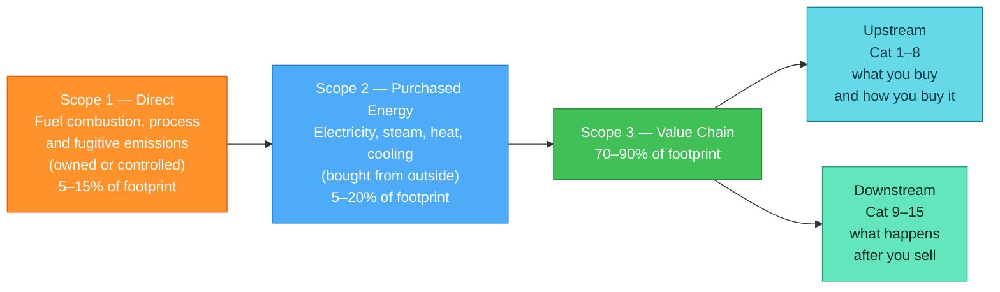

# Scope 3 Emissions: The Hardest Problem in Corporate Climate Action

A rigorously sourced, **16-part guide** to Scope 3 greenhouse-gas emissions — from a zero-prerequisites primer and a full worked calculation, to regulatory detail, real company data, and the market infrastructure that could actually solve it. Built for **beginners and subject-matter experts alike**.

!!! abstract "TL;DR"
    - **Scope 3 = 70–90% of most companies' real climate footprint** — yet it is largely invisible, estimated, and underreported.
    - The problem is **structural**: data gaps, misaligned incentives, standard fragmentation, and no market mechanism to finance supplier action.
    - The winners will not be those who *report* best — **they will be those who build operational infrastructure to *manage* Scope 3.**

---

## The Three Scopes at a Glance

> **The implication:** climate pledges that cover only Scope 1 and 2 address at most 30% of a company's actual impact.

---

## Start Here: Choose Your Path

| I am… | Start with | Then go to |
|-------|-----------|------------|
| **Completely new to Scope 3** | [Scope 3 101](08_scope3_101.md) | [Worked Example](09_worked_example.md) → [Fundamentals](01_scope3_fundamentals.md) |
| **Executive / Board member** | [Executive Summary](00_executive_summary.md) | [Abatement Challenges](04_abatement_challenges.md) → [Quick Reference](15_quick_reference.md) |
| **Sustainability / ESG lead** | [Fundamentals](01_scope3_fundamentals.md) | [Complexity](02_complexity_challenges.md) → [Standards](06_standards_regulatory.md) |
| **Finance / Risk team** | [Standards & Regulatory](06_standards_regulatory.md) | [Banking case study](03_industry_case_studies.md) → [Data](07_industry_data_and_benchmarks.md) |
| **Seasoned practitioner** | [Advanced Topics](12_advanced_topics.md) | [Data & Benchmarks](07_industry_data_and_benchmarks.md) |

**🌱 Beginner track:** [Scope 3 101](08_scope3_101.md) → [Worked Example](09_worked_example.md) → [Fundamentals](01_scope3_fundamentals.md) → [Common Mistakes](10_common_mistakes.md).

**🎓 Expert track:** [Complexity](02_complexity_challenges.md) → [Standards](06_standards_regulatory.md) → [Data](07_industry_data_and_benchmarks.md) → [Advanced Topics](12_advanced_topics.md).

Both converge on [Abatement Challenges](04_abatement_challenges.md) → [Carbon3 Solution](05_carbon3_solution.md).

---

## Quick Answers

**What is Scope 3?**
All the indirect greenhouse-gas emissions in a company's value chain — upstream (what it buys, Categories 1–8) and downstream (what happens after it sells, Categories 9–15). It is typically **70–90% of a company's total carbon footprint**.

**What are the 15 Scope 3 categories?**
The GHG Protocol defines 15 categories. Purchased goods & services (Cat 1), use of sold products (Cat 11), and investments/financed emissions (Cat 15) dominate most sectors. See the [full list](01_scope3_fundamentals.md).

**Why is Scope 3 so hard to measure?**
Because the data lives with suppliers who have little incentive to share it, and the cheapest method (spend-based emission factors) can be off by **±100–400%**.

**Is Scope 3 disclosure mandatory?**
Increasingly, yes — the EU's **CSRD** requires it for large companies, and **California's SB 253** plus **ISSB S2** add pressure. The US SEC rule is currently paused.

**What's the difference between offsets and insets?**
Offsets are reductions *outside* your value chain (not attributable to a Scope 3 category); insets are verified reductions *inside* your supply chain, attributable to a specific category.

**How do you actually reduce Scope 3?**
Supplier switching, financed supplier improvement, product redesign, green procurement, and insetting — not by measuring alone.

---

## The Numbers That Matter

| Stat | Value | Source |
|------|-------|--------|
| Scope 3 share of a typical footprint | **70–90%** | GHG Protocol / sector data |
| Supply-chain S3 vs. operational S1+S2 | **26× larger** | BCG/CDP (June 2024) |
| Companies disclosing *any* Scope 3 | **74.3%** (1,033 of 1,391) | Carbon3 Registry |
| Companies with a Scope 3 reduction target | **15%** | BCG/CDP (June 2024) |
| Implied carbon liability (3 sectors, $75/t) | **$335 billion** | BCG/CDP (June 2024) |
| Total voluntary carbon market value (2024) | **$535 million** | Ecosystem Marketplace 2025 |

*Full sourcing in [Industry Data & Benchmarks](07_industry_data_and_benchmarks.md).*

---

## Browse the Guide

- **Core narrative** — [Executive Summary](00_executive_summary.md) → [Fundamentals](01_scope3_fundamentals.md) → [Complexity](02_complexity_challenges.md) → [Case Studies](03_industry_case_studies.md) → [Abatement](04_abatement_challenges.md) → [Carbon3 Solution](05_carbon3_solution.md) → [Standards](06_standards_regulatory.md) → [Data](07_industry_data_and_benchmarks.md)
- **Learn & apply** — [Scope 3 101](08_scope3_101.md) · [Worked Example](09_worked_example.md) · [Common Mistakes](10_common_mistakes.md) · [Templates](11_templates.md) · [Advanced Topics](12_advanced_topics.md)
- **Reference** — [Glossary](13_glossary.md) · [FAQ](14_faq.md) · [Quick Reference](15_quick_reference.md)

---

*Built by [Carbon3 Global Pte. Ltd.](https://carbon3.net) — building the market infrastructure that makes supply-chain decarbonisation financially self-sustaining.*
